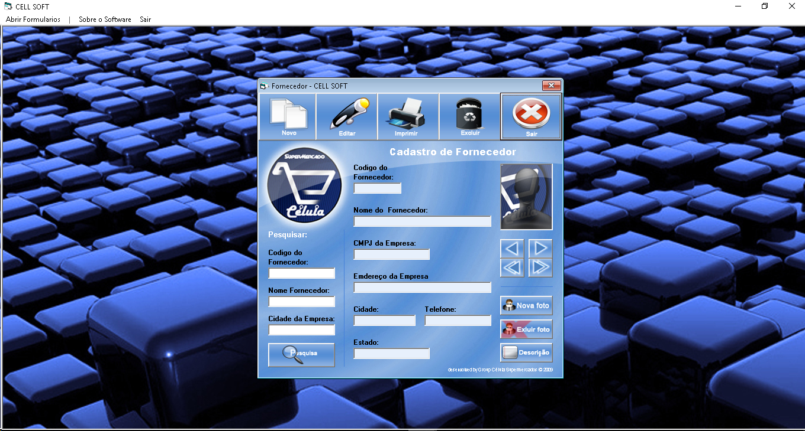

<h3 align="center">  SUPER-MERCADO CELULA  

  
</h3>

## 📃 Descrição do projeto

Projeto Super-mercado Celula desenvolvido em Visual Basic 6 (VB6), como projeto final do módulo 3 do curso SENAC. O sistema tem como objetivo auxiliar no gerenciamento de um supermercado, disponibilizando funcionalidades para cadastro e gerenciamento de funcionários, fornecedores, produtos, estoque e vendas, utilizando um banco de dados Microsoft Access.

 

 

## :hammer: Funcionalidades do projeto

- `Funcionalidade 1`: Cadastro e gerenciamento de funcionários, incluindo informações pessoais, dados de contato, endereço, data de nascimento e descrição do funcionário.
- `Funcionalidade 2`: Cadastro e gerenciamento de produtos e fornecedores, incluindo informações de identificação, descrição, preços, quantidade em estoque e dados dos fornecedores.
- `Funcionalidade 3`: Gerenciamento de vendas e itens vendidos, com funcionalidades para registro, consulta, edição, exclusão e navegação entre registros, além do controle de produtos e quantidades comercializadas.

 
  
## 📁 Acesso ao projeto

Todo o código-fonte do projeto, arquivos do Visual Basic 6, banco de dados Microsoft Access e executáveis compilados se encontram na pasta **code**.

Os recursos gráficos, imagens, ícones e elementos visuais utilizados pelo sistema estão disponíveis na pasta **material**.

 
  
## 🛠️ Abrir e rodar o projeto

Utilize o ``Visual Basic 6`` para abrir o arquivo ``PJCelula.vbp``, localizado na pasta **code**, para visualizar, editar e executar o projeto.

O projeto utiliza o banco de dados Microsoft Access (`Celula.mdb`) e a biblioteca DAO 3.51 para acesso e manipulação dos dados.

Também estão disponíveis executáveis compilados do sistema na pasta **code**.

   
  
## ✔️ Técnicas e tecnologias utilizadas

&nbsp;&nbsp;
&nbsp;&nbsp;
&nbsp;&nbsp;

 
- ``Visual Basic 6 (VB6)``
- ``Microsoft Access (MDB)``
- ``DAO 3.51 (Data Access Objects)``
- ``Windows Forms (VB6 Forms)``
- ``Git``
 
   
  
## Autor

| [ Felipe Lima](https://github.com/felip3fl) | 
| :---: 
  
 
    
## Licença

Docusaurus is [MIT licensed](./LICENSE).

The Docusaurus documentation (e.g., `.md` files in the `/docs` folder) is [Creative Commons licensed](./LICENSE-docs).
